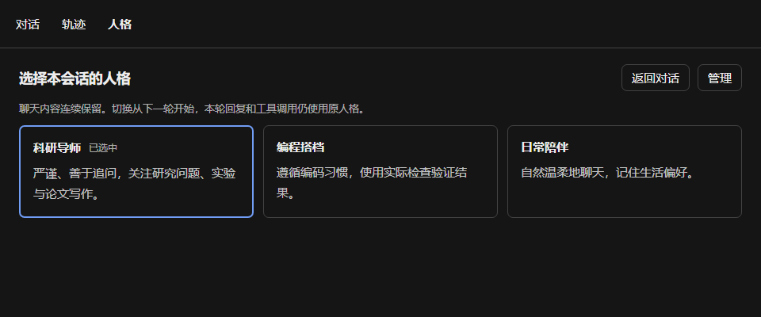
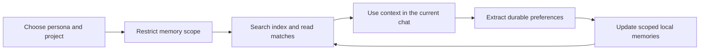
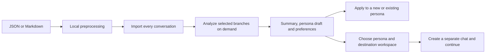
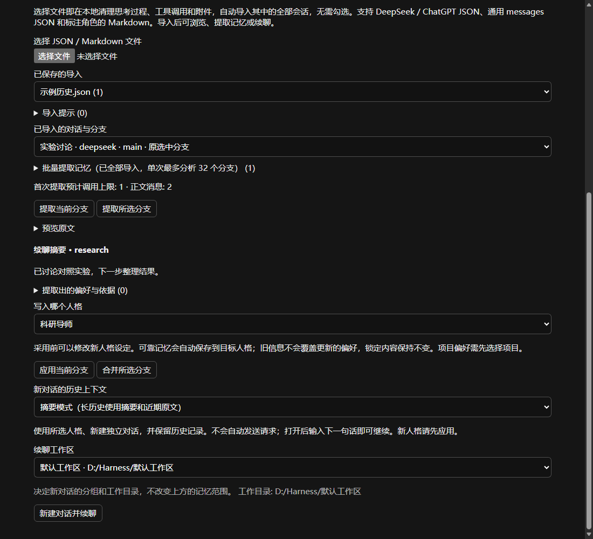

# DSH Persona Memory

**Give DeepSeek Harness different personas, each with its own memory of you.**

[简体中文](README.md) · English

An independent Cordis plugin for DeepSeek Harness (DSH), with multiple personas, local long-term memory, preference learning, and conversation-history continuation. Web and Desktop share the same UI, with no changes to Harness source code.

[Why this plugin](#why-this-plugin) · [Features](#features) · [Installation](#installation) · [Usage](#usage) · [Storage and configuration](#storage-and-configuration) · [Development](#development) · [Roadmap](#roadmap)

## Why this plugin

Working with an AI assistant often means repeating the same context: your research direction, writing preferences, coding style, project conventions, and preferred tone. Some of that context can disappear when you start a new chat or when a long conversation is compacted.

Different tasks also call for different assistants. For research, you may want a mentor who questions assumptions and examines evidence. For programming, you may want a partner who follows project conventions and verifies results with real checks. For everyday conversation, a more relaxed companion may fit better. Putting all those preferences in one global memory can make them interfere with one another.

This plugin has three goals:

- **Retain useful long-term information**, so new conversations need less repeated setup.
- **Keep memories with their persona and project**, allowing research, coding, and daily conversation to develop separately.
- **Make past conversations useful again**, turning exported chats into searchable material, durable preferences, and new Harness conversations.

“Learning” here means extracting, retrieving, and updating memories. It does not train or fine-tune a model. You control the persona’s core instructions; preference memories accumulate through use.

## Features

| Feature | Available today |
| --- | --- |
| Multiple personas | Built-in research mentor, coding partner, and daily companion; create and edit your own |
| Switching within a chat | A Persona tab alongside Chat and Trace; changes apply to the next turn while history stays continuous |
| Scoped memory | Cross-project memories for each persona, plus separate project memories within that persona |
| Automatic learning | Reliable durable preferences are saved and updated without an item-by-item approval queue |
| Manual control | Inspect, correct, forget, lock, and prioritize memories |
| On-demand recall | Search an index before reading matching bodies, with bounded memory injection |
| Whole-file history import | Common DeepSeek / ChatGPT JSON exports, generic messages JSON, and role-marked Markdown |
| History continuation | Extract summaries, persona drafts, and preferences; create a separate native chat from a history branch |
| Workspace placement | Choose a workspace or Ungrouped for the new chat, independently of memory scope |
| Optional extensions | Configured project checks and semantic recall through Ollama or an embeddings-compatible service |

### Persona switching



*UI preview with sample data in Chinese. Appearance varies with the Harness version and theme.*

Persona isolation applies to long-term memory retrieval and writes. All personas can still refer to earlier messages in the same chat. Switching does not replace the Harness capability preset, tool permissions, or approval rules.

### How memory remains useful



Updates consider the user’s original words, evidence dates, and existing memories. Locked content and newer evidence are protected. Model judgments can still be wrong, so correction, forgetting, and locking remain available.

## Installation

### Requirements

| Component | Requirement |
| --- | --- |
| DeepSeek Harness | `>=0.2.1-rc.3 <0.3.0-0`, including later 0.2.x prereleases and stable releases |
| Cordis | `^4.0.5`, supplied by the host; development baseline: 4.0.5 |
| Node.js | Node 24+ for development and the offline CLI; Desktop uses its bundled runtime |
| Model | Uses models already configured in Harness; no duplicate chat API-key setup |

There are no install-time scripts. Normal use does not require a separate database, Python, or Docker. Optional embedding services must be prepared separately.

### Install a release archive

Download [dsh-persona-memory-0.8.4-alpha.1.tgz](https://github.com/wuxingyu1231z/dsh-persona-memory/releases/download/v0.8.4-alpha.1/dsh-persona-memory-0.8.4-alpha.1.tgz) directly, or visit [GitHub Releases](https://github.com/wuxingyu1231z/dsh-persona-memory/releases) for release notes and checksums. The package has not been publicly published to npm.

**Desktop:** open the application’s Plugins installer, enter the absolute path to the `.tgz`, then fully quit and restart the application.

**Web:** on the machine running the Harness Host, execute:

```bash
dsh --profile web plugin add "/absolute/path/dsh-persona-memory-0.8.4-alpha.1.tgz"
```

The Web Plugins installer is also supported. Replace the example with the actual absolute path; Windows paths such as `C:/Downloads/dsh-persona-memory-0.8.4-alpha.1.tgz` work as well. In a remote Web deployment, the install path refers to the **Host machine**, not the browser’s computer.

When running Harness from source, use `pnpm dsh` from its repository instead of `dsh`. Web and Desktop use separate profiles and need separate installations. See the [installation and distribution guide](docs/DISTRIBUTION.md) for details; the extended guides are currently in Chinese.

### Upgrade from an earlier release

Install `0.8.4-alpha.1` once for rc.3, rc.4, and rc.5. Later 0.2.x updates are also allowed without an exact-version installation block. Fully quit and restart Harness after installing. The existing memory directory is reused; if the installer requires removing the old plugin first, retain local data.

| Plugin release | Supported DSH |
| --- | --- |
| **`0.8.4-alpha.1`** | **`>=0.2.1-rc.3 <0.3.0-0`** |

Development APIs stay pinned to the minimum supported rc.3 baseline. A single build is exercised on rc.3 / rc.4 / rc.5, and startup checks identify missing required interfaces. Future versions within the range are allowed to install, although unreleased behavior cannot be verified in advance. DSH 0.3.x and later need separate adaptation. No version exemption is required.

### Build and install from source

Clone this repository, enter its directory, and use Node 24+:

```bash
npm install
npm run check
npm pack --ignore-scripts --pack-destination releases
```

Install the resulting `releases/dsh-persona-memory-0.8.4-alpha.1.tgz` using the steps above. Generated `lib/` and `releases/` directories are not tracked in Git. Installing a local source directory also requires a build first; an unbuilt Git repository URL is not a supported installable artifact.

## Usage

### 1. Create and select a persona

After installation, open **Personas & memory** in the sidebar. This independent page lets you create personas, edit their names and instructions, and manage their memories.

Inside a conversation, open the **Persona** tab and choose a role. The selection applies to the next turn; an ongoing response and its tool calls keep the persona active when that turn started.

You can also send this command on its own:

```text
/persona
```

It lists persona IDs. Then send one of the following:

| Persona | Command |
| --- | --- |
| Research mentor | `/persona research-mentor` |
| Coding partner | `/persona coding-partner` |
| Daily companion | `/persona daily-companion` |

The new-chat landing page does not currently have a separate persona picker. Run the switching command before your first substantive message. The research mentor is the default. Browsing a persona on the management page does not change any chat’s persona.

### 2. Build and manage memories

For example, while using the research mentor, say:

> Please remember: when discussing experiment results, give me the conclusion first, followed by the evidence and limitations.

Each persona can use Automatic learning, Explicit preferences only, or Pause automatic learning. The model saves or updates information it judges to be reliable and durable; core persona instructions remain under your control.

Use **Save a memory** to add an entry manually, or **Correct**, **Forget**, and **Lock** to manage existing entries. Important memories can be prioritized for recall. See [learning and project checks](docs/LEARNING.md) for the detailed rules.

### 3. Import history and continue a conversation



1. Open **Personas & memory → Import history & continue**. Create a persona first if needed, or use an existing one.
2. Choose a JSON or Markdown file. Local preprocessing removes structurally identifiable thinking, tool activity, and attachment bodies, then automatically uploads **every conversation** in batches. Visible text, code, timestamps, and branches are retained.
3. Browse the imported conversations and branches. Choose a configured model and select **Analyze current branch** or **Analyze selected branches**. This is where model calls begin.
4. Review the summary and evidence. Apply the results to a persona, or edit the draft to create a new one. Reliable memories are saved directly, without per-item approval.
5. Choose the history-context mode and **Workspace for the new chat**, then select **Create a chat and continue**. Once it opens, type your next message.

A single conversation with many branches is automatically partitioned. Each branch keeps its full prefix, original identity, and preferred-branch status; all parts are committed as one archive without manually splitting the export.

**Whole-file import requires no conversation selection.** Checkboxes after import control only that analysis batch, with up to 32 branches per batch; long histories may require multiple model requests. A continuation uses one branch, rather than stitching alternative branches into an invented conversation.



*UI preview with sample history in Chinese.*

| Setting | What it controls |
| --- | --- |
| Memory scope | Which project receives extracted project preferences; cross-project preferences still belong to the target persona |
| Workspace for the new chat | The new chat’s sidebar group and working directory |

Use Summary mode for long histories: the model receives a summary and recent text, while the complete text remains in the local archive and session log. The `persona_history` tool can look up details. Creating the chat does not automatically send a model request.

The source-file limit is currently 64 MB, with additional per-conversation and branch limits. ZIP, HTML, and attachment restoration are not supported. See [history import and continuation](docs/IMPORT.md) for formats, budgets, retries, and the optional offline preprocessing CLI.

## Storage and configuration

The default location is `$DSH_HOME/memory`, or `~/.dsh/memory` when `DSH_HOME` is unset. Personas and canonical memory records use readable Markdown files:

```text
memory/
├── personas/
│   └── research-mentor/
│       ├── PERSONA.md              # User-defined persona core
│       ├── PROFILE.md              # Generated user-profile excerpts
│       ├── MEMORY.md               # Short navigation index
│       ├── memories/               # Cross-project memories for this persona
│       ├── projects/
│       │   └── <project-id>/
│       │       ├── memories/       # Memories for this persona and project
│       │       └── SUMMARY.md      # Generated project summary
│       └── revisions/              # Previous content and metadata
├── state/                         # Selections, jobs and rebuildable indexes
├── imports/                       # Normalized history and analysis checkpoints
├── continuations/                 # Archive-to-chat associations
└── semantic/                      # Optional vector cache
```

Edit `PERSONA.md` and canonical memory entries through the management UI or their files. `PROFILE.md`, `MEMORY.md`, and `SUMMARY.md` are derived and may be rebuilt on refresh. Default retrieval searches indexes before reading bodies; it does not send every memory to the model each turn. See [storage and on-demand retrieval](docs/STORAGE.md).

Override settings in your Harness personal profile patch, for example:

```yaml
- id: persona-memory
  config:
    defaultPersona: research-mentor
    learningMode: auto
    recallLimit: 8
    maxContextChars: 12000
```

Examples: [custom memory directory](examples/custom-memory.cordis.patch.yml) · [project checks](examples/verification.cordis.patch.yml) · [semantic recall](examples/embedding.cordis.patch.yml). Project verification needs configured checks and reports actual exit codes; it does not guarantee that every programming answer automatically runs a check.

### Data and model calls

Memories and archives are stored as ordinary local files. **Local storage does not mean all processing is offline:**

| Operation | Model or external-service use |
| --- | --- |
| Persona switching, manual memory management, preprocessing and whole-file import | No model calls |
| Background preference learning and explicit history analysis | Uses the model configured in Harness and may incur charges |
| Creating a continuation | No automatic model call; sending the next message follows normal chat billing |
| Optional semantic recall | When enabled, scoped memories and queries are sent to the configured embedding service |

Forgetting a memory removes its canonical body, revisions, and derived index content. It does not remove original chats, imported archives, or snapshots already recorded in sessions. Uninstalling the plugin also leaves the memory directory intact.

## Development

Bug reports, improvement proposals, and pull requests are welcome. Include the plugin and DSH versions, Web or Desktop environment, reproduction steps, and redacted errors in a report.

### Project layout

| Path | Responsibility |
| --- | --- |
| `src/index.ts` | Host integration, per-turn persona binding, management and continuation |
| `src/client/` | Persona tab, management page, and import UI |
| `src/store.ts`, `src/memory-index.ts` | Storage, revisions, scoping, and indexed retrieval |
| `src/learning.ts` | Extraction jobs, deduplication, updates, and recovery |
| `src/preprocess.ts`, `src/import-*.ts`, `src/continuation.ts` | History preprocessing, parsing, analysis, and native continuation |
| `src/schema.ts`, `src/transport.ts` | Shared validation and Host/Client transport contracts |
| `tests/`, `scripts/` | Regressions, builds, UI checks, and installation validation |

### Useful commands

```bash
npm run typecheck      # Check types
npm test               # Run source regressions
npm run build          # Build Host, Client and public declarations
npm run test:package   # Check built entry points and browser factory
npm run check          # Run the normal release checks above
```

The build checks host dependency versions. Changes to persona binding, memory ownership, or history flows should retain regressions for persona/project isolation, retries, and restart recovery. Add UI text to both languages in `src/client/locales.ts`.

To validate against an actual installation, prepare an isolated runtime copy:

```bash
node scripts/prepare-installed-runtime.mjs "/absolute/path/to/DSH"
npm run check:installed
```

This path requires a readable Desktop installation archive. `check:installed` uses its recorded Node executable and DSH copy, and additionally checks compatibility and real workspace behavior. Run `npm run check:ui` for visual checks; it defaults to Windows Edge. Set `PERSONA_TEST_BROWSER` to another compatible Chromium executable if needed.

Run `npm run check:compat` for regression checks of the same build on rc.3 / rc.4 / rc.5; see the [compatibility guide](docs/COMPATIBILITY.md) for fixture preparation. Exact development dependencies make tests reproducible; `engines.dsh` and host peer ranges govern installation compatibility.

Before a release, build and pack the `.tgz`, then run `node scripts/smoke-install.mjs` to test installation in an isolated profile. The optional `--upgrade` check requires the local `0.8.3-alpha.1` archive in `releases/` and a DSH rc.3 test copy to verify upgrading both the host and plugin. Set `PERSONA_UPGRADE_RUNTIME` to specify the old runtime directory. See the [validation record](VALIDATION.md) and [compatibility guide](docs/COMPATIBILITY.md) for the tested scope.

## Roadmap

- More platform export samples and ZIP / HTML adapters.
- More complete backup, export, and archive management for memories and personas.
- Better project identity across directory moves and Git worktrees.
- Explicitly user-controlled sharing of memories across personas.
- Real-model evaluation, cross-platform installation, accessibility, and mobile improvements.

These are planned capabilities, not promises of existing behavior. See the [design](docs/DESIGN.md) and [roadmap](docs/ROADMAP.md) for background.

## License

[MIT](LICENSE). Bundled dependency licenses are listed in [THIRD_PARTY_NOTICES.md](THIRD_PARTY_NOTICES.md). This is an independent plugin, not an official DeepSeek product.
