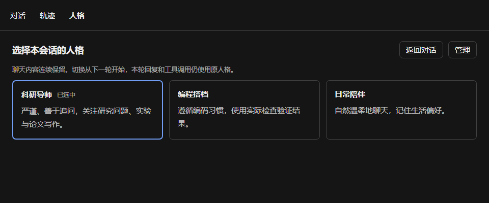
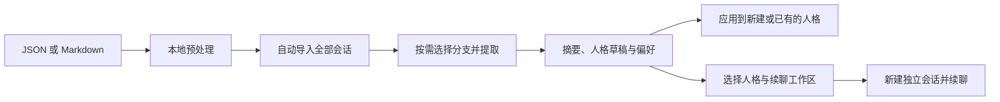
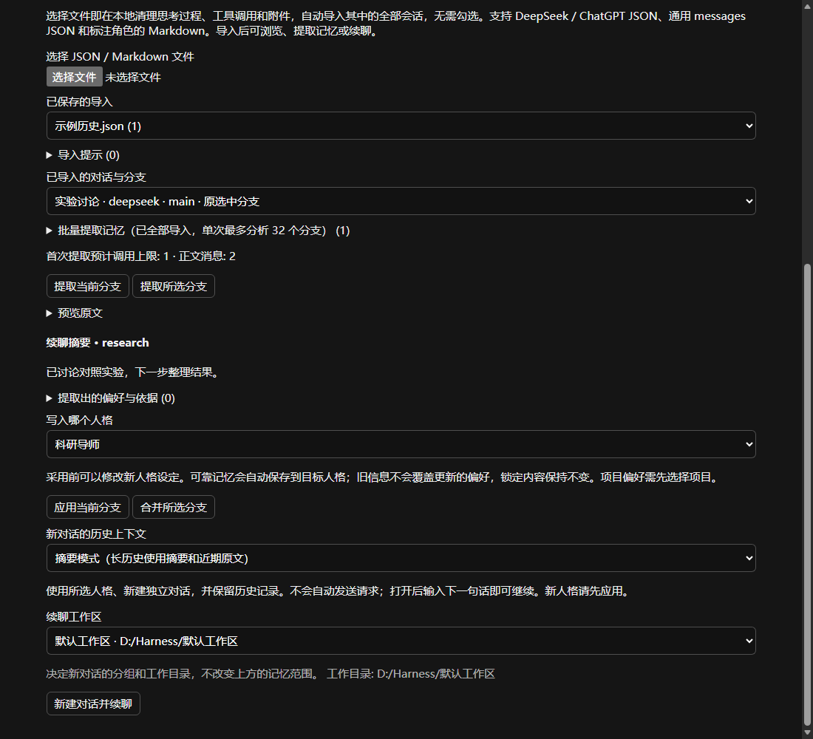

# DSH Persona Memory

**让 DeepSeek Harness 在不同角色下，记住不同的你。**

简体中文 · [English](README.en.md)

为 DeepSeek Harness（DSH）提供多个人格、本地长期记忆、偏好学习和历史对话续聊能力的独立 Cordis 插件。Web 与 Desktop 共用一套界面，无需修改 Harness 源码。

[为什么做这个插件](#为什么做这个插件) · [主要功能](#主要功能) · [安装](#安装) · [使用](#使用) · [本地存储与配置](#本地存储与配置) · [参与开发](#参与开发) · [后续计划](#后续计划)

## 为什么做这个插件

持续使用一个 AI 助手时，很多上下文需要反复交代：研究方向、论文写作习惯、代码风格、项目约定，以及日常交流中喜欢的表达方式。这些信息可能随着会话切换或上下文压缩而丢失。

同一个人，在不同场景下需要的助手也不同。科研时希望它像导师，追问假设、检查证据；编程时希望它遵循项目习惯，用实际检查验证结果；日常聊天时，则可能更喜欢轻松自然的陪伴。把这些偏好全部混进一份全局记忆，很容易让它们互相干扰。

这个插件希望解决三件事：

- **记住长期有用的信息**，减少每次开启新对话时的重复说明。
- **让记忆跟随人格和项目**，使科研、编程与日常交流各自积累适合自己的偏好。
- **接续过去的交流**，把导出的历史对话整理成可检索的资料、偏好记忆和新的 Harness 会话。

这里的“学习”通过提取、检索和更新记忆实现，不涉及训练或微调模型。人格核心由用户定义，偏好记忆在使用中逐渐积累。

## 主要功能

| 功能 | 当前能力 |
| --- | --- |
| 多人格 | 内置科研导师、编程搭档、日常陪伴，可新建和编辑人格设定 |
| 同会话切换 | 在顶部“对话 / 轨迹 / 人格”中切换，从下一轮生效，聊天内容连续保留 |
| 记忆隔离 | 每个人格拥有自己的跨项目记忆，并可进一步保存项目独立记忆 |
| 自动学习 | 从对话中提取可靠的长期偏好，自动保存和更新，无需逐条确认 |
| 手动管理 | 查看、纠正、忘掉、锁定记忆，并将重要条目标记为优先召回 |
| 按需召回 | 先检索索引，再读取命中正文，控制注入模型的记忆数量和长度 |
| 历史整包导入 | 支持常见 DeepSeek / ChatGPT JSON、通用 messages JSON 和角色标记 Markdown |
| 历史续聊 | 从历史分支生成摘要、提取人格草稿与偏好，并创建独立原生会话继续交流 |
| 工作区选择 | 创建续聊时选择工作区或“未分组”，与记忆范围分别设置 |
| 可选扩展 | 支持配置项目校验，以及 Ollama / embeddings 兼容服务的语义召回 |

### 人格切换



*界面示意，使用演示数据；实际外观随 Harness 版本和主题变化。*

人格隔离针对长期记忆的检索与保存。同一会话里的历史聊天仍可被所有人格参考；切换人格不会替换 Harness 的能力预设、工具权限或审批规则。

### 记忆如何持续发挥作用


系统结合用户原话、来源时间和已有记忆判断更新关系；锁定内容与更新的证据受到保护。模型判断仍可能出错，因此保留人工纠正、忘掉和锁定操作。

## 安装

### 环境要求

| 项目 | 要求 |
| --- | --- |
| DeepSeek Harness | `>=0.2.1-rc.3 <0.3.0-0`，包含后续 0.2.x 预发布版和正式版 |
| Cordis | `^4.0.5`，由宿主提供，开发基线为 4.0.5 |
| Node.js | 开发与离线命令需要 Node 24+；Desktop 使用自带运行时 |
| 模型 | 使用 Harness 中已配置的模型，不需要给插件重复填写聊天 API 密钥 |

插件没有安装时执行脚本。普通用户无需额外部署数据库、Python 或 Docker；可选的嵌入服务需要自行准备。

### 使用发布包安装

直接下载 [dsh-persona-memory-0.8.4-alpha.1.tgz](https://github.com/wuxingyu1231z/dsh-persona-memory/releases/download/v0.8.4-alpha.1/dsh-persona-memory-0.8.4-alpha.1.tgz)，或前往 [GitHub Releases](https://github.com/wuxingyu1231z/dsh-persona-memory/releases) 查看发布说明和校验文件。目前尚未公开发布 npm 包。

**Desktop：**打开桌面应用的“插件”安装入口，填写 `.tgz` 文件的绝对路径，完成后完全退出并重新启动应用。

**Web：**在运行 Harness Host 的机器上执行：

```bash
dsh --profile web plugin add "/absolute/path/dsh-persona-memory-0.8.4-alpha.1.tgz"
```

也可以使用 Web 的“插件”安装入口。将示例替换为实际绝对路径；Windows 可使用 `C:/Downloads/dsh-persona-memory-0.8.4-alpha.1.tgz`。远程 Web 部署的安装路径指向 **Host 机器**，不是浏览器所在电脑。

如果通过 Harness 源码启动应用，可在 Harness 仓库中将 `dsh` 替换为 `pnpm dsh`。Web 与 Desktop 使用不同的 profile，需要分别安装。更多方式见[安装与分发说明](docs/DISTRIBUTION.md)。

### 从旧版升级

安装 `0.8.4-alpha.1` 后，rc.3、rc.4、rc.5 使用同一个插件包；升级到后续 0.2.x 时也不会因版本号变化被直接拦截。安装后完全退出并重启 Harness。插件继续使用原来的 memory 目录；若插件页要求先卸载旧版，请保留本地数据。

| 插件版本 | 支持的 DSH |
| --- | --- |
| **`0.8.4-alpha.1`** | **`>=0.2.1-rc.3 <0.3.0-0`** |

开发接口固定在最低支持版本 rc.3；发布构建保持一份，并在 rc.3 / rc.4 / rc.5 上分别运行回归。启动时检查必要接口，遇到缺失能力会给出具体提示。范围内的未来版本允许安装，但尚未发布的版本无法预先保证行为；DSH 0.3.x 及以上需要另行适配。无需开启版本豁免。

### 从源码构建安装

克隆本仓库，进入项目目录，并确保当前使用 Node 24+：

```bash
npm install
npm run check
npm pack --ignore-scripts --pack-destination releases
```

安装生成的 `releases/dsh-persona-memory-0.8.4-alpha.1.tgz`，方式同上。源码仓库中的 `lib/` 和 `releases/` 不纳入 Git；直接安装本地目录前也必须先完成构建。未构建的 Git 仓库地址不能直接作为当前插件的安装包使用。

## 使用

### 1. 创建与选择人格

安装后，点击侧栏 **“人格与记忆”**，进入独立管理页。这里可以新建人格、编辑名称和设定，也可以管理对应的记忆。

进入会话后，点击顶部 **“人格”** 页签，选择需要的角色。从下一轮开始使用新人格；正在进行的回复和工具调用仍归属原人格。

也可以单独执行命令：

```text
/persona
```

查看人格 ID，再执行其中一条：

| 人格 | 切换命令 |
| --- | --- |
| 科研导师 | `/persona research-mentor` |
| 编程搭档 | `/persona coding-partner` |
| 日常陪伴 | `/persona daily-companion` |

新会话首页目前没有单独的人格选择按钮，可以先执行切换命令，再发送正式问题。未指定时默认使用科研导师。管理页中正在浏览的人格不会自动成为某个会话的人格。

### 2. 积累和管理记忆

例如，在科研导师人格下说：

> 请记住：讨论实验结果时，我希望先看到结论，再说明证据和限制。

每个人格可独立选择“自动学习”“仅明确偏好”或“暂停自动学习”。模型判断可靠的长期信息后直接保存或更新；人格核心设定仍由用户编辑。

在管理页中，可以通过“保存一条记忆”手动添加条目，也可以使用“纠正”“忘掉”“锁定”管理已有内容。重要条目可以标记为优先召回。详细规则见[学习与项目校验](docs/LEARNING.md)。

### 3. 导入历史对话并续聊



1. 打开侧栏“人格与记忆 → 历史导入与续聊”。可以先新建人格，也可以使用已有的人格。
2. 选择 JSON 或 Markdown 文件。插件在本地清理可识别的思考过程、工具活动和附件本体，自动分批导入文件中的**全部会话**，保留可见正文、代码、时间和分支关系。
3. 导入完成后，浏览对话与分支；选择已经配置的模型，点击“提取当前分支”或“提取所选分支”。这是开始调用模型的步骤。
4. 查看摘要及提取依据，将结果应用到目标人格，或编辑草稿后创建新人格。可靠记忆直接保存，无需逐条确认。
5. 选择历史上下文模式与“续聊工作区”，点击“新建对话并续聊”。新会话打开后，输入下一句话即可继续。

分支较多的单个会话会自动拆批处理，保留各分支完整前文、原始标识和选中分支；全部处理完成后仍保存为一个归档，无需手动拆分文件。

**整包导入不需要勾选会话。**导入后的批量勾选仅控制本次记忆分析，单次最多分析 32 个分支。续聊一次对应一个分支，不将不同分支拼接成虚构对话。



*使用演示历史的界面示意。*

| 选项 | 决定什么 |
| --- | --- |
| 记忆范围 | 提取的项目偏好写入哪个项目；跨项目偏好仍属于目标人格 |
| 续聊工作区 | 新会话在左侧显示在哪个分组，以及使用哪个工作目录 |

长历史推荐使用摘要模式：模型参考摘要和近期正文，完整正文仍保留在本地归档与会话日志中，需要时可通过 `persona_history` 查找。创建会话本身不会自动发送模型请求。

当前原始文件上限为 64 MB，单个会话及分支也有独立限制；不支持 ZIP、HTML 和附件恢复。具体格式、预算、失败重试和可选离线预处理命令见[历史导入与续聊说明](docs/IMPORT.md)。

## 本地存储与配置

默认存储目录为 `$DSH_HOME/memory`；未设置 `DSH_HOME` 时使用 `~/.dsh/memory`。人格与正式记忆使用可读的 Markdown 文件：

```text
memory/
├── personas/
│   └── research-mentor/
│       ├── PERSONA.md              # 用户定义的人格核心
│       ├── PROFILE.md              # 自动生成的用户画像摘录
│       ├── MEMORY.md               # 简短导航索引
│       ├── memories/               # 本人格的跨项目记忆
│       ├── projects/
│       │   └── <project-id>/
│       │       ├── memories/       # 本人格在该项目下的独立记忆
│       │       └── SUMMARY.md      # 自动生成的项目摘要
│       └── revisions/              # 修改记录与旧版本
├── state/                         # 选择、任务与可重建的检索索引
├── imports/                       # 规范化历史与提取检查点
├── continuations/                 # 历史与新会话的关联
└── semantic/                      # 可选向量缓存
```

`PERSONA.md` 与正式记忆条目可通过管理页或文件编辑；`PROFILE.md`、`MEMORY.md` 和 `SUMMARY.md` 是派生文件，刷新时可能重建。默认检索先查索引、后读正文，并非每次将全部记忆送入模型。详见[存储与按需检索](docs/STORAGE.md)。

可以在 Harness 的个人 profile patch 中覆盖配置，例如：

```yaml
- id: persona-memory
  config:
    defaultPersona: research-mentor
    learningMode: auto
    recallLimit: 8
    maxContextChars: 12000
```

完整示例：[自定义记忆目录](examples/custom-memory.cordis.patch.yml) · [项目校验](examples/verification.cordis.patch.yml) · [语义召回](examples/embedding.cordis.patch.yml)。项目校验需要先配置适用的检查，插件依据实际退出码报告结果，不保证每次编程回答都会自动运行检查。

### 数据与模型调用

记忆与归档以普通本地文件保存。**本地保存不等于所有处理都离线**：

| 操作 | 是否调用模型或外部服务 |
| --- | --- |
| 人格切换、手动记忆管理、本地预处理与整包导入 | 不调用模型 |
| 后台偏好学习、手动历史提取 | 使用 Harness 中配置的模型，可能产生费用 |
| 创建续聊会话 | 不自动调用模型；发送下一条消息后按正常聊天计费 |
| 可选语义召回 | 启用后向所配置的嵌入服务发送相应范围的记忆和查询 |

“忘掉”记忆会清理对应正文、旧版本和派生索引，但不会删除原始聊天、导入归档或既有会话中的快照。卸载插件也不会自动删除记忆目录。

## 参与开发

欢迎提交缺陷报告、改进建议和 Pull Request。报告问题时，请附上插件与 DSH 版本、Web / Desktop 环境、复现步骤和脱敏后的错误信息。

### 项目结构

| 路径 | 职责 |
| --- | --- |
| `src/index.ts` | Host 集成、人格轮次绑定、管理与续聊入口 |
| `src/client/` | 人格页签、管理页和历史导入界面 |
| `src/store.ts`、`src/memory-index.ts` | 本地存储、修订、作用域与索引检索 |
| `src/learning.ts` | 偏好提取任务、去重、更新和失败恢复 |
| `src/preprocess.ts`、`src/import-*.ts`、`src/continuation.ts` | 历史预处理、解析、提取与原生续聊 |
| `src/schema.ts`、`src/transport.ts` | 共享数据校验与 Host / Client 通信约定 |
| `tests/`、`scripts/` | 回归测试、构建、界面与安装验证 |

### 常用命令

```bash
npm run typecheck      # 类型检查
npm test               # 源码回归测试
npm run build          # 构建 Host、Client 与公开类型
npm run test:package   # 构建后验证入口与浏览器工厂
npm run check          # 以上常规发布检查
```

构建会核对宿主依赖版本。修改人格绑定、记忆归属或历史流程时，应保留跨人格、跨项目、重试及重启恢复的回归覆盖；新增界面文字需要同时更新 `src/client/locales.ts` 中的中英文内容。

如果需要对实际安装包进行验证，可准备隔离运行时副本：

```bash
node scripts/prepare-installed-runtime.mjs "/absolute/path/to/DSH"
npm run check:installed
```

这条路径依赖可读取的 Desktop 安装包。`check:installed` 使用其中记录的 Node 与 DSH 副本，额外验证兼容性及实际工作区行为。界面检查可运行 `npm run check:ui`，默认使用 Windows Edge；其他兼容 Chromium 浏览器可通过 `PERSONA_TEST_BROWSER` 指定可执行文件。

多版本回归可执行 `npm run check:compat`，默认验证 rc.3 / rc.4 / rc.5 的同一构建。开发依赖精确版本用于复现测试，安装兼容范围由 `engines.dsh` 和宿主 peers 声明。

发布前先构建并生成 `.tgz`，再运行 `node scripts/smoke-install.mjs` 验证独立测试 profile 的安装。`--upgrade` 还需要本地 `releases/` 中的 `0.8.3-alpha.1` 包及 DSH rc.3 测试副本，用于验证宿主与插件一起升级；旧运行时可通过 `PERSONA_UPGRADE_RUNTIME` 指定。详细边界见[验证记录](VALIDATION.md)。

## 后续计划

- 增加更多平台导出样本及 ZIP / HTML 适配。
- 提供更完整的记忆、人格与归档备份导出管理。
- 改善项目移动与 Git worktree 的项目标识衔接。
- 支持用户明确控制的跨人格记忆共享。
- 完善真实模型评估、跨平台安装、无障碍与移动端体验。

这些能力属于后续计划，当前版本不承诺已实现。设计与演进记录见[设计说明](docs/DESIGN.md)和[路线图](docs/ROADMAP.md)。

## 许可证

[MIT](LICENSE)。随构建分发的依赖许可证见 [THIRD_PARTY_NOTICES.md](THIRD_PARTY_NOTICES.md)。本项目是独立插件，不属于 DeepSeek 官方产品。
